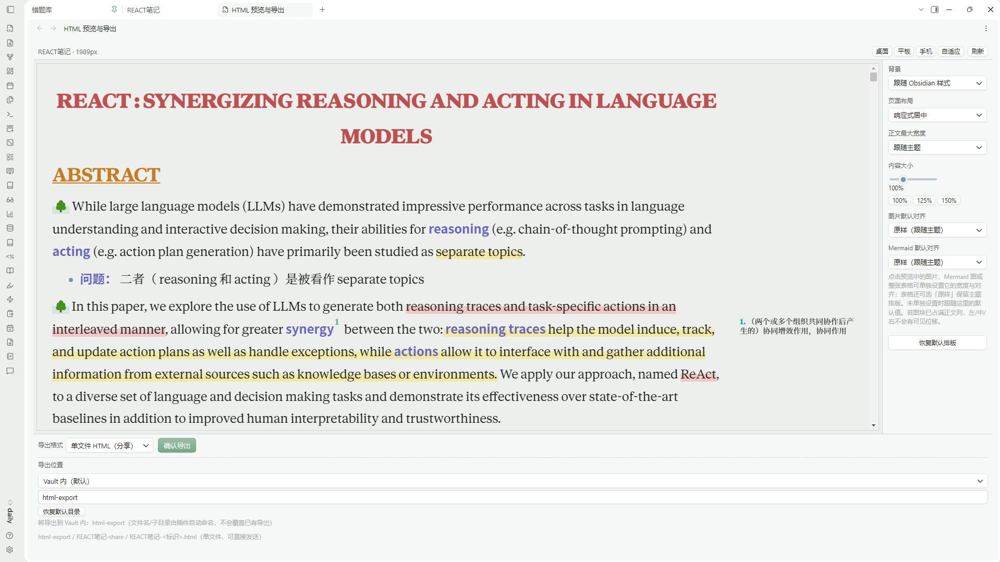

**Language: English | [简体中文](README.zh-CN.md)**

# HTML Export Preview

Export the current Obsidian **reading view** (the already-rendered page) as a standalone HTML file you can open anywhere — then tune images, Mermaid diagrams, and tables on the exported copy **before** saving.

Unlike "export markdown as HTML" tools, this plugin captures what you actually see: the active theme, your CSS snippets, media, and Side Notes, all resolved into a self-contained file.

> Status: desktop-only, requires Obsidian **1.15.0** or later (see [Limitations](#limitations)). **Not yet listed in the Obsidian community plugin directory** — use [BRAT or a manual install](#installation).



*The real Obsidian desktop interface: review the rendered page, switch responsive presets, tune the layout, and choose an export format in one window.*

## Features

- **Preview before you write.** A built-in editor shows the rendered page with responsive width presets (1440 / 820 / 420 px and fluid) so you confirm the result before any file is written.
- **Standalone HTML.** Export the current note as a single self-contained `.html` file (images, fonts, and styles inlined) that opens offline in any browser.
- **Asset-bundle export.** Alternatively export a folder with an `assets/` directory, keeping media external (handy for large media or for hosting the folder).
- **Theme & snippets preserved.** The active theme and your CSS snippets are collected so the export looks like your vault.
- **Side Notes aware.** Margin / side-note content is laid out into the exported page.
- **Single-element tuning.** Select an image, a Mermaid diagram, or a **table** in the right-hand panel and adjust width (original / percent / px) and alignment (left / center / right), or reset to defaults. Changes apply to the export, not your note.
- **Same-article anchors.** In-page `#heading` links jump inside the preview/export instead of opening a new tab.
- **Export anywhere.** Write to any directory your OS account can write — including outside the vault.
- **Safe overwrite.** When the target exists, you get an explicit **Replace / Save-as / Cancel** choice; cancel never touches the old file, and replace only affects the exact file you confirmed.
- **Locate after export.** On desktop, the output is revealed in the system file manager (toggle in settings).
- **Local integrity signing (folder export).** The **asset-bundle / folder export** writes a sidecar `export-manifest.json` carrying a per-file SHA-256 and an HMAC-SHA256 signature under a per-vault key, so you can verify a folder was produced by this vault. The single-file export is self-contained and does **not** include this manifest.

## Installation

**This plugin has not yet been accepted into the Obsidian community plugin directory.** Searching for it under *Settings → Community plugins → Browse* will not find it at this time. Use one of the two working options below instead.

### Option A — Install with BRAT

1. In Obsidian, open *Settings → Community plugins → Browse*, search for **BRAT** (Obsidian42 — BRAT), install it and enable it.
2. Open the **BRAT** settings tab and use **Add Beta Plugin** (or run BRAT's *Add a beta plugin* command from the command palette).
3. Enter the GitHub repository `1569y/html-export-preview` (the full URL `https://github.com/1569y/html-export-preview` also works) and confirm.
4. BRAT downloads `main.js`, `manifest.json` and `styles.css` from the latest GitHub Release and installs them into `.obsidian/plugins/html-export-preview/`.
5. Go to *Settings → Community plugins* and enable **HTML Export Preview**. Reload Obsidian if the plugin does not appear immediately.

To update later, use BRAT's update action for this beta plugin.

### Option B — Manual installation

1. Open the [Releases page](https://github.com/1569y/html-export-preview/releases) and, from the latest release, download `main.js`, `manifest.json` and `styles.css`.
2. Create the folder `.obsidian/plugins/html-export-preview/` inside your vault.
3. Copy the three files into that folder.
4. Reload Obsidian, then enable **HTML Export Preview** in *Settings → Community plugins*.

To upgrade, replace `main.js` and `styles.css`. Keep `data.json` — it holds your local settings.

## How to Use

1. **Open an Obsidian note.** Reading view and edit view both work; from edit view the plugin briefly switches to reading view to capture, then restores your original mode.
2. **Launch the HTML preview and layout editor.** Run **HTML Export Preview: Open HTML preview & layout editor** from the command palette, or click the ribbon icon **HTML 导出：预览与排版**. A second command, **HTML Export Preview: Re-capture and open HTML preview**, forces a fresh capture of the current note.
3. **Preview the rendered note.** Switch the toolbar width presets (桌面 / 平板 / 手机 / 自适应 — Desktop 1440px / Tablet 820px / Phone 420px / Fluid) and use 刷新 to re-capture while keeping your layout. Nothing is written to disk until you confirm an export.
4. **Select images, Mermaid diagrams, or tables** by clicking them in the preview; adjust their width (original / percent / px), alignment (left / center / right), or reset them in the right-hand panel. Page background, content width and zoom can be set globally.
5. **Choose single-file HTML or resource-folder export** in the footer's 导出格式 selector — 单文件 HTML（分享） or 完整资源包（归档）.
6. **Select a destination and export.** Choose the Vault-internal folder, or use 浏览… to pick a location outside the vault, then press 确认导出.

All layout changes apply to the exported copy only — the original note is never modified. Closing the preview tab cancels silently without writing any file.

### Opening the preview

1. Open a note in **reading view or edit view** — both work. From edit mode the plugin briefly switches the note to reading view to capture, then restores your original mode.
2. Run the command **HTML Export Preview: Open HTML preview & layout editor** from the command palette, or click the ribbon icon.
   - A second command, **HTML Export Preview: Re-capture and open HTML preview**, forces a fresh capture of the current note.
3. In the preview, **click an image, a Mermaid diagram, or a table** to select it; its width and alignment become editable in the right-hand panel.
4. Review the preview with the responsive presets. Nothing is written to disk until you confirm an export.

### Adjusting images, Mermaid diagrams & tables

- Select an element by **clicking it in the preview** — an **image**, a **Mermaid diagram**, or a **table**. The right-hand panel then shows its **width** (original / percent / px) and **alignment** (left / center / right) controls, plus a reset-to-defaults option.
- These adjustments apply to the **export only** — your original note is never modified.
- Blocks you have not individually tuned follow the panel's global defaults.

### Single-file export

Export the current note as one self-contained `.html` file. Images, fonts, and styles are inlined so the file opens offline in any browser with no sibling files.

### Asset-bundle export

Export a folder that contains an `index.html` plus an `assets/` directory holding the media externally. Choose this when you prefer to keep large media out of the HTML, or when you want to publish/host the folder as a unit.

## Directories outside the vault

You may write exports to **any directory your OS account can write**, including locations outside the vault. The default export folder lives inside the vault (recommended, because Obsidian indexes it and plugin updates won't overwrite it), but you can point the export path anywhere.

## Overwrite confirmation

When the export target already exists, the plugin asks explicitly:

- **Cancel** — keeps the existing file untouched; nothing is written.
- **Replace** — the plugin first re-checks the existing file's SHA-256, writes an exclusive backup of it, performs the final file swap as a single atomic rename, then re-verifies the result. The swap itself is atomic: your original file is never altered except by that rename. The backup and post-swap verification exist to detect a bad swap and restore the old file, but they are separate steps rather than one atomic transaction. If the operation is **interrupted abnormally** (for example a crash or power loss mid-swap), a `.he-backup-*.html` file may be left on disk and could require **manual recovery** — the plugin does not guarantee automatic recovery after an abnormal termination. On an ordinary (non-interrupted) failure the old file is preserved or restored automatically.
- **Save-as** — writes a new file under a different name.

No file is ever overwritten without this explicit confirmation.

## Anchors: same-article supported, cross-note not guaranteed

- **Same-article anchors work.** In-page `#heading` links jump within the preview/export instead of opening a new browser tab.
- **Cross-note / wiki-link navigation is NOT guaranteed.** Links to other notes generally do not resolve in a standalone export and may not work offline. If you rely on in-file navigation, keep the related content within the same note.

## Privacy & network access

This plugin is **desktop-only** and performs **no telemetry, analytics, advertising, auto-update, or phone-home** behavior. It makes **no network requests unless you export** a note that references remote resources.

- **File system.** The plugin reads its own settings file (`data.json`) when it loads. It reads the active note's rendered content and media only when you open a preview or start an export, and writes exported HTML (and assets) only to a directory **you choose**, which may be outside the vault. Note content is never sent anywhere.
- **No telemetry or background traffic.** There is no telemetry, analytics, advertising, auto-update, or phone-home, and no periodic or background network activity of any kind.
- **Network requests at export time (user-initiated).** To make an export self-contained, when your note's own CSS or fonts reference **remote `http(s)` URLs** (for example web-hosted fonts), the plugin `fetch`es exactly those URLs and inlines their contents. These requests are triggered by your export action and scoped to URLs already present in your note's styles. There is **no telemetry sent to the plugin author or any analytics service** — the plugin never reports your activity anywhere. Note, however, that the **third-party servers hosting those fonts/CSS do receive ordinary HTTP requests** (and the associated metadata such as your IP address, the requested URL, and a standard User-Agent). An export that references such remote assets is therefore not produced "completely offline"; the fetches happen once, during that export. If a remote asset cannot be retrieved, the exported page may differ from the preview.
- **Local secrets.** The integrity-signing key is a per-vault HMAC key derived and stored locally in the plugin's `data.json`. It is never transmitted and never leaves your machine.
- **Electron.** On desktop it uses `electron.shell.showItemInFolder` solely to reveal the exported file in your file manager (toggleable in settings).

## Limitations

- **Desktop only.** Relies on Node `fs` and Electron; will not run on mobile (declared `isDesktopOnly`).
- **Rendered view, not source.** Export reflects the reading view as Obsidian renders it; some dynamically scripted or externally-embedded interactive content may not capture perfectly.
- **Remote assets need network at export time.** Notes referencing web-hosted fonts/CSS fetch them once during export (see [Privacy](#privacy--network-access)).
- **Element tuning targets the export**, not the original note.
- Requires Obsidian **1.15.0** or later. This floor reflects the version on which the plugin has actually been run and tested; earlier versions are not claimed as supported because they have not been verified.

## Plugin interface language

This is the default **English** README; a [Simplified Chinese edition](README.zh-CN.md) is available as well. The plugin's **in-app interface** — the settings tab, the overwrite-confirmation dialog, and the layout/tuning panel — is currently written in **Chinese**. The command names and the documentation are in English; localizing the in-app UI is planned but not yet done. The Chinese labels quoted in [How to Use](#how-to-use) are the ones you will actually see on screen.

## Feedback

- **Bug reports & feature requests:** open an issue at <https://github.com/1569y/html-export-preview/issues>.
- Please include your Obsidian version, the plugin version (from `manifest.json`), and the steps to reproduce. Do not attach screenshots containing private note content.

## Development

```bash
npm ci
npm run typecheck   # tsc -noEmit -skipLibCheck
npm test            # offline unit suites, run under Node
npm run build       # esbuild production bundle -> main.js
```

`main.js` is the generated plugin entry point; get official builds from [Releases](https://github.com/1569y/html-export-preview/releases). End-to-end UI verification requires a real Obsidian desktop instance and is performed manually by the maintainer; it is not part of the unit suites in this repository.

## License

MIT — see [LICENSE](./LICENSE). · Author: [1569y](https://github.com/1569y)
