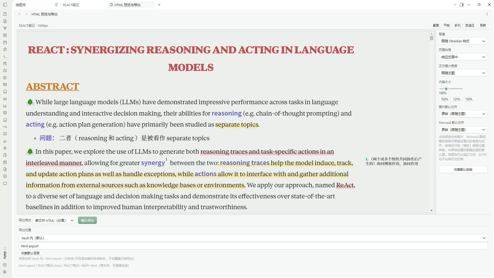

**语言：[English](README.md) | 简体中文**

# HTML Export Preview

**把 Obsidian 里排好版的笔记，导出成一个可以单独打开、保存和分享的 HTML 网页。**

[下载 0.1.0](https://github.com/1569y/html-export-preview/releases/tag/0.1.0)

> 当前版本 **0.1.0** · 仅支持桌面端 · 需要 Obsidian **1.15.0** 或更高版本  
> 目前**尚未收录进 Obsidian 官方社区插件目录**，请通过 [BRAT](#方式一使用-brat-安装) 或 [手动安装](#方式二手动安装) 安装。



*图示为真实的 Obsidian 桌面端界面：在同一个窗口里检查导出效果、切换屏幕宽度、调整排版，并选择导出方式。*

## 主要功能与优势

- **保留原来的笔记样式**：从 Obsidian 已经渲染好的阅读视图生成 HTML，尽量保留当前主题、CSS 片段、图片、高亮、Mermaid 图表和 Side Notes。
- **导出前先看效果**：内置预览编辑器，可切换桌面、平板、手机和自适应宽度，确认排版后再写文件。
- **单独调整元素**：点击图片、Mermaid 图表或表格，调整宽度与对齐；也可以统一设置背景、内容宽度和显示比例。
- **两种导出方式**：单文件 HTML，或带 `assets/` 目录的资源包。
- **不改原始笔记**：所有排版调整只作用于导出的副本，不会回写 Obsidian 笔记。
- **保存位置可选**：可以保存到 Vault 内，也可以通过桌面文件选择器保存到 Vault 外的指定位置。

### 保留的是渲染结果，不是 Markdown 源码

常见的「Markdown 转 HTML」只保留文字结构，主题配色、CSS 片段和笔记里各种插件渲染出来的效果容易丢失。本插件抓取的是 Obsidian 已经渲染完成的阅读视图，因此导出的网页更接近你实际看到的样子。不同主题和第三方插件的渲染方式存在差异，最终效果请以预览结果为准。

### 导出前预览，减少反复试错

预览编辑器可以切换不同屏幕宽度，检查文字、图片和图表在窄屏下的排布。在点击确认导出之前，插件不会写出任何文件，也不会改动原笔记。

### 点选元素单独调整

在预览画面里点击**图片、Mermaid 图表或表格**，右侧面板即可调整它的宽度（原样 / 百分比 / 像素）和对齐方式（左 / 中 / 右），并可恢复默认。未单独调整的元素跟随全局设置。页面背景、正文宽度、整体对齐和缩放也可以统一设置。

### 两种导出方式

| 导出方式 | 得到什么 | 适合什么时候用 |
| --- | --- | --- |
| **单文件 HTML** | 一个 `.html` 文件，图片与所需样式尽量内联 | 分享单篇笔记、归档、在浏览器中直接打开 |
| **资源包导出** | `index.html` 加上独立的 `assets/` 资源目录 | 图片较多、希望单独管理资源，或部署为静态页面 |

### 保存位置与覆盖确认

导出位置可以选 Vault 内目录，也可以通过桌面文件选择器指定 Vault 外的目录。如果目标文件已经存在，插件会提供**覆盖 / 另存为 / 取消**三种选择；取消不会改动原有文件。导出成功后，可在系统文件管理器中定位结果。

## 安装方法

**目前尚未上架 Obsidian 官方社区插件目录**，暂时无法在「设置 → 社区插件」中搜索到本插件。请使用下面两种方式之一。

### 方式一：使用 BRAT 安装

1. 在 Obsidian 的社区插件中安装并启用 **BRAT**。
2. 打开 BRAT 的 **Add a beta plugin**。
3. 填入仓库地址：`https://github.com/1569y/html-export-preview`。
4. 安装完成后，在 **设置 → 社区插件** 中启用 **HTML Export Preview**。

### 方式二：手动安装

1. 打开 [0.1.0 Release](https://github.com/1569y/html-export-preview/releases/tag/0.1.0)，下载 `main.js`、`manifest.json`、`styles.css` 三个文件。
2. 在你的 Vault 中创建目录 `.obsidian/plugins/html-export-preview/`。
3. 把这三个文件放进该目录。
4. 重新加载 Obsidian，进入 **设置 → 社区插件**，启用 **HTML Export Preview**。

> 升级时同样替换 `main.js` 和 `styles.css` 即可，`data.json` 中保存的是本机设置，请保留。

## 基础使用教程

1. **打开笔记**：在 Obsidian 中打开要导出的单篇笔记，阅读模式或编辑模式都可以（从编辑模式进入时，插件会临时切换到阅读视图完成抓取，再恢复原来的模式）。
2. **打开预览**：通过命令面板运行 **HTML Export Preview: Open HTML preview & layout editor**，或点击侧边栏的插件图标。
3. **检查并调整**：切换设备宽度查看排版；点击图片、Mermaid 图表或表格，在右侧调整宽度和对齐。
4. **确认导出**：选择单文件 HTML 或资源包，设置保存位置，点击确认导出。之后在浏览器中打开结果检查最终效果。

## 已知限制与隐私说明

- **仅支持桌面端**：依赖 Node 文件系统与 Electron 能力，不支持 Obsidian 移动端（`isDesktopOnly: true`）。需要 Obsidian **1.15.0** 或更高版本。
- **导出的是渲染视图**：依赖脚本或外部嵌入的互动内容，不一定能与 Obsidian 内显示得完全一致。
- **跨笔记链接不保证可用**：支持同一篇 HTML 内部的标题锚点跳转；指向其他笔记的链接在独立 HTML 中通常无法解析，离线打开时可能失效。需要页内跳转的内容请放在同一篇笔记里。
- **远程资源需要联网**：如果笔记的样式引用了远程 CSS 或字体，导出时插件会尝试获取并内联这些资源。此时会向托管这些资源的第三方服务器发出正常网络请求，对方可能获得 IP、请求地址等常规网络元数据；若资源获取失败，导出结果可能与预览有差异。
- **不会回写原笔记**：排版调整只影响导出的副本。
- **插件界面目前主要为中文**：设置页、覆盖确认框和排版面板使用中文显示。
- **隐私**：插件没有遥测、使用统计、广告、自动更新或回传行为，不会向作者发送笔记内容。文件夹导出会额外写入用于本地完整性检查的 `export-manifest.json`（单文件 HTML 不带此清单）；签名密钥保存在本机 `data.json` 中，不会外传。

## 开发者信息

本项目使用 TypeScript 与 esbuild 构建。`main.js` 是构建生成的插件入口，正式发行版请从 [Releases](https://github.com/1569y/html-export-preview/releases/tag/0.1.0) 获取。从源码验证或参与开发可以运行：

```bash
npm ci
npm run typecheck   # tsc -noEmit -skipLibCheck
npm test            # Node 下离线运行的单元测试
npm run build       # esbuild 生产构建，输出 main.js
```

端到端界面验收需要真实的 Obsidian 桌面端，由维护者在本地手动完成，公开仓库中的单元测试不包含这部分。

发现问题或有建议，欢迎在 [GitHub Issues](https://github.com/1569y/html-export-preview/issues) 反馈。建议附上 Obsidian 版本、插件版本和复现步骤，截图请不要包含私人笔记内容。

## 许可证

[MIT License](LICENSE) · 作者 [1569y](https://github.com/1569y)
